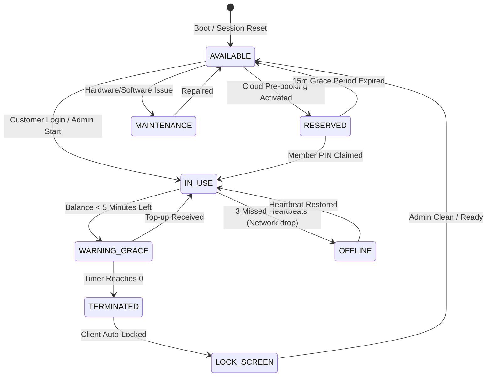

# NetKeep Cafe — System Architecture & Technical Specification

## 1. System Overview

**NetKeep Cafe** is a hybrid Edge-Cloud Internet & Gaming Cafe Management System. It is engineered to solve the primary operational vulnerabilities of traditional cyber cafes: internet outages halting local billing, lack of remote multi-branch visibility, workstation theft/unauthorized usage, and complex network segmentation.

### Core Architecture Philosophy: Hybrid Edge-Cloud
- **Local Edge Server (FastAPI + SQLite)**: Runs physically inside the cafe on a local management machine or server appliance. It operates with zero internet dependency, managing real-time workstation heartbeats, automated terminal locking, hourly session billing, and local point-of-sale (POS).
- **Cloud Central API (FastAPI + Supabase PostgreSQL)**: Provides centralized multi-branch oversight, user global identity & wallet top-up, advance seat reservations, aggregated telemetry, and cross-branch analytics.
- **Bi-Directional Resilient Sync**: An asynchronous queue worker continuously flushes offline billing and session records to the cloud when connectivity is active, handling network drops seamlessly.

---

## 2. High-Level Architecture Diagram

```mermaid
graph TB
    subgraph Cloud["Cloud Infrastructure (Supabase + FastAPI)"]
        CA[Cloud Central API]
        CDB[(Supabase PostgreSQL)]
        CAuth[Cloud Auth & Global Wallets]
        CA --- CDB
        CA --- CAuth
    end

    subgraph Internet["Public Internet / WAN"]
        SyncStream[Encrypted TLS Sync Stream]
    end

    subgraph LocalCafe["Cyber Cafe LAN (Edge Environment)"]
        Router[Cisco Router / Gateway]
        Switch[Cisco Managed Switch (VLANs 10-50)]
        
        subgraph EdgeServer["Edge Management Server"]
            LocalAPI[FastAPI Local Server]
            LDB[(SQLite NetKeep DB)]
            SyncWorker[Edge Sync Worker]
            HeartbeatMgr[Terminal Heartbeat Daemon]
            LocalAPI --- LDB
            LocalAPI --- SyncWorker
            LocalAPI --- HeartbeatMgr
        end

        subgraph Terminals["Cyber Cafe Workstations"]
            PC1["VIP Gaming Rig 01\n(Client Agent)"]
            PC2["VIP Gaming Rig 02\n(Client Agent)"]
            PC3["Workstation 03\n(Standard)"]
            PC4["Private Booth 04"]
        end

        subgraph ManagementUI["Staff & Admin Consoles"]
            AdminUI["Next.js Web Dashboard\n(Front Desk POS)"]
            KioskUI["Self-Service Kiosk\n(Booking & Topup)"]
        end
    end

    AdminUI -->|REST / WebSocket| LocalAPI
    KioskUI -->|REST| LocalAPI
    PC1 <-->|Heartbeat & Lock Signals| HeartbeatMgr
    PC2 <-->|Heartbeat & Lock Signals| HeartbeatMgr
    PC3 <-->|Heartbeat & Lock Signals| HeartbeatMgr
    PC4 <-->|Heartbeat & Lock Signals| HeartbeatMgr

    SyncWorker <-->|Batched JSON Sync| SyncStream
    SyncStream <-->|HTTPS Ingestion| CA
```

---

## 3. Network Architecture & VLAN Segmentation

A professional cyber cafe requires strict network segregation to prevent ARP spoofing, broadcast storms, packet sniffing of other users' web traffic, and protection of the admin billing server.

| VLAN ID | Name | Subnet | Gateway | Purpose |
|---|---|---|---|---|
| **VLAN 10** | Management & Billing | `192.168.10.0/24` | `192.168.10.1` | Local Edge Server, Front Desk POS, CCTV, Admin PCs |
| **VLAN 20** | VIP Gaming Rig Pod | `192.168.20.0/24` | `192.168.20.1` | Low-latency gaming PCs, high bandwidth QoS priority |
| **VLAN 30** | General Surfing PCs | `192.168.30.0/24` | `192.168.30.1` | Standard internet browsing, document printing stations |
| **VLAN 40** | Public Guest Wi-Fi | `192.168.40.0/24` | `192.168.40.1` | BYOD mobile devices, client laptops (Isolated via ACL) |
| **VLAN 50** | Network Peripherals | `192.168.50.0/24` | `192.168.50.1` | Heavy-duty laser printers, NAS local game caching server |

### Access Control Rules (ACL Matrix):
- **VLAN 40 (Guest Wi-Fi)**: Permitted to access Internet only. Denied access to VLAN 10, 20, 30, and 50.
- **VLAN 20 & 30 (Terminals)**: Permitted to communicate with VLAN 10 only on TCP Port `8000` (Local Server API) for heartbeat and authentication. Client-to-client traffic between PCs is blocked via Switch Port Isolation (Private VLANs) to eliminate LAN malware spread.
- **VLAN 10 (Admin)**: Full management access to all VLANs and network switches/routers.

---

## 4. Workstation Lifecycle & State Machine



---

## 5. Billing & Rate Computation Model

1. **Station Rate Tiers**:
   - `VIP_GAMING`: $3.50/hr (RTX 4080, 240Hz, Mechanical Peripherals)
   - `STANDARD_PC`: $1.50/hr (Core i5, 144Hz, Standard Browsing/Study)
   - `PRIVATE_BOOTH`: $4.00/hr (Acoustic padding, Dual Monitors, Stream ready)

2. **Billing Modes**:
   - **Prepaid (Fixed Duration)**: User pays upfront for $N$ minutes or hours. At $t - 5\text{ min}$, audio-visual prompt alerts user. At $t = 0$, the client OS locks.
   - **Postpaid (Open Metered)**: Session ticks in 1-minute increments. Final invoice calculated at check-out.
   - **Member Wallet**: Balance is debited in real-time. If balance hits $0, session grace period activates.

---

## 6. Edge-Cloud Synchronization Protocol

1. **Write-Ahead Local Logging**: Every transaction, session start, station state transition, and POS purchase is immediately written to SQLite with a `sync_status = 'PENDING'` flag and timestamp.
2. **Background Sync Worker**: Runs every 10 seconds.
   - Queries `SELECT * FROM sync_logs WHERE sync_status = 'PENDING' LIMIT 50`.
   - Sends payload batch to `POST /api/v1/sync/ingest` on Cloud API.
   - On HTTP `200 OK`, updates SQLite rows to `sync_status = 'SYNCED'`.
3. **Idempotency**: Every sync event has a UUID `sync_event_id`. The Cloud API checks for duplicate UUIDs before insertion, preventing double-billing or corrupted counts upon network retries.

---

## 7. Security Architecture

1. **Client Machine Security**:
   - Custom client lock-screen shell that disables Windows key shortcuts (`Alt+Tab`, `Ctrl+Alt+Del`, `Win+L`) until unlocked by the server.
   - UDP/TCP Heartbeat token signed with rotating HMAC-SHA256 secret.
2. **Database Isolation**:
   - SQLite WAL (Write-Ahead Logging) mode enabled for high-concurrency local reads and writes without database lockups.
   - Cloud Supabase PostgreSQL protected with Row Level Security (RLS) and branch-scoped JWT tokens.
